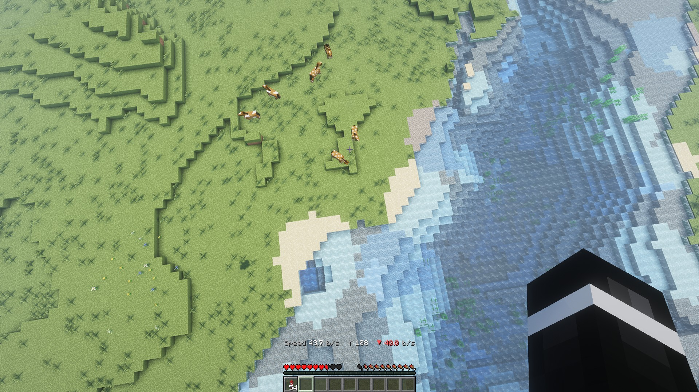

# Elytra HUD

<p align="center"></p>

A vanilla Minecraft Java data pack. While you glide with an elytra, the actionbar shows:

```
Speed 32.4 b/s   Y 187   ▼ 3.2 b/s
```

- **Speed**: total speed in blocks per second, one decimal
- **Y**: your altitude
- **▲ / ▼**: climb (green) or sink (red) rate in blocks per second

No mods, no resource pack. Works in singleplayer and on servers, for every player separately.



## Requirements

Minecraft Java Edition **26.1 to 26.3** (data pack formats 101 to 121).

## Install

1. Download `elytra-hud.zip` from the [latest release](https://github.com/christoph-teichmeister/elytra-hud/releases/latest).
2. Put the zip (do not unpack it) into your world's `datapacks` folder:
   - Singleplayer: *Edit world → Open world folder → datapacks*, or pick it under *Data Packs* when creating a world.
   - Server: `world/datapacks/`.
   - CurseForge app: it shows *"This profile's Data packs need to be loaded manually"* because vanilla Minecraft only loads data packs per world. That is expected: download the zip and put it into the world's `datapacks` folder as above.
3. Run `/reload` (or rejoin the world). `/datapack list` should show `file/elytra-hud.zip`.

## Use

- Just glide. The HUD appears on its own and disappears when you land.
- `/trigger elytra_hud` turns it off or on again for yourself (no operator rights needed).

## Uninstall

Run `/function elytra_hud:uninstall` (removes its scoreboards), then `/datapack disable "file/elytra-hud.zip"` and delete the zip.

## How it works

Every tick, players with the `is_fall_flying` flag get their position read in milliblocks. The difference to the previous tick gives the velocity; speed is the length of that vector (integer square root via Newton's method on scoreboards), climb rate is the Y part. Teleports (more than 10 blocks in one tick) are skipped. Players who are not gliding cost one predicate check per tick.

Predicates changed their type key from `condition` to `type` in 26.3, so the 26.3 version of the predicate lives in the overlay `overlay_121`; older versions use the base one.

Known limit: scoreboard values are 32-bit, so beyond about 2.1 million blocks from 0,0 the HUD stops working.

## Testing status

Every pull request loads the pack on headless 26.1, 26.1.1, 26.1.2, 26.2 and 26.3 servers and fails on any data pack error. The speed and climb math was checked with entities moved by known distances, and the HUD was played in a 26.1.2 client (see the screenshots in `art/screenshots/`).

## License

MIT
